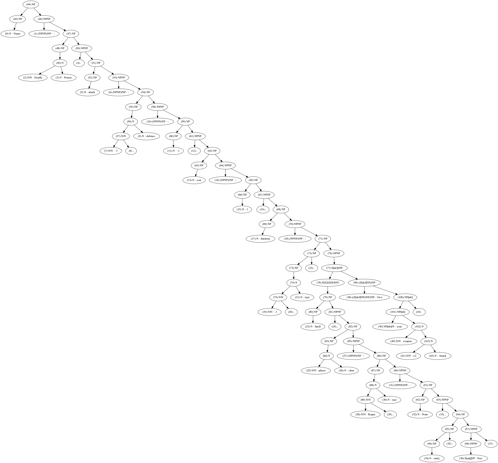
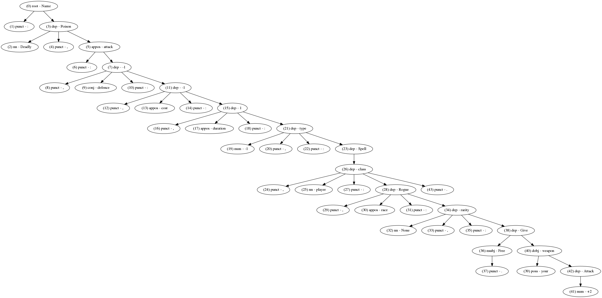
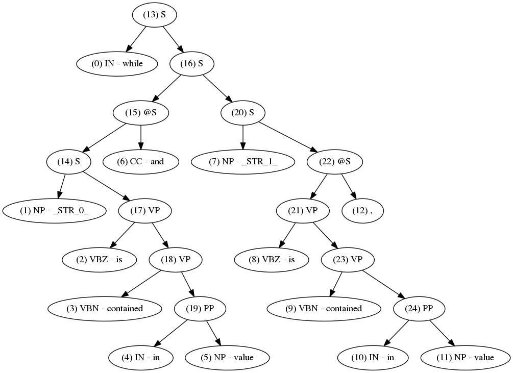

# treelstm-code-generation

A PyTorch implementation of a Tree2Tree neural network that translates natural language descriptions into source code, built for my MS thesis *"Generation of code from text description with syntactic parsing and Tree2Tree model"*.

The idea: parse the input sentence into a syntax tree (CCG, PCFG, or dependency), encode it with a recursive tree-LSTM, and decode the output as a sequence of grammar rules that assemble a target-language AST — rather than generating code token-by-token. It's heavily inspired by [Yin & Neubig's "A Syntactic Neural Model for General-Purpose Code Generation"](https://arxiv.org/abs/1704.01696) and follows a similar structure to their reference implementation, [NL2code](https://github.com/neulab/NL2code).

Trained and evaluated on two NL-to-code datasets:
- **HearthStone (hs)** — card text → Python card implementations
- **Django** — Django docstrings/comments → Python code

## Example syntax trees

| CCG | Dependency | PCFG |
|---|---|---|
|  |  |  |

## Usage

```bash
sh fetch_and_preprocess.sh          # downloads + preprocesses the datasets
python experiment_hs.py             # train/evaluate on HearthStone
python experiment_django.py         # train/evaluate on Django
```

Model and training options (encoder type, syntax formalism, embedding sizes, copy mechanism, etc.) live in `config.py`.

## Status

This was a research/thesis project, not production code — expect rough edges. Kept around as a record of a fun grad-school rabbit hole into grammar-based code generation.
